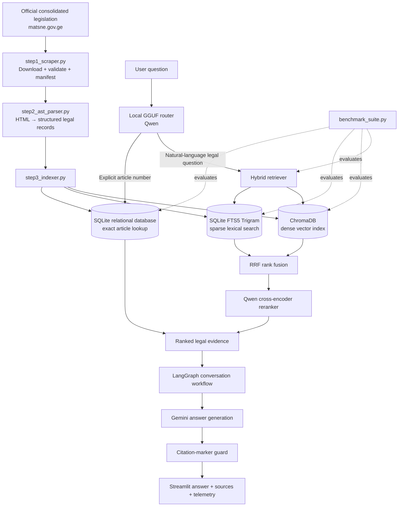

<div align="center">

# Georgian Legal AI

### A citation-aware legal research assistant for Georgian legislation

A local-first, multi-stage Retrieval-Augmented Generation (RAG) system designed to retrieve, rank, and explain provisions from Georgia's legal codes in Georgian — with article-level source references and a visible retrieval trace.

[**Repository**](https://github.com/LukichaX/georgian-legal-ai) · [**Matsne — Legislative Herald of Georgia**](https://matsne.gov.ge/)


</div>

> **Important:** This is an experimental legal-information and research project, not a substitute for a qualified lawyer. Generated answers can be incomplete or wrong. Verify every important conclusion against the current official legal text and consult a legal professional for decisions with real-world consequences.

---

## Why this project?

Legal RAG is not just a matter of splitting PDFs into chunks and sending the nearest passages to an LLM. Georgian legislation has a structured hierarchy, article numbers can include *prima facie* suffixes (for example, `144¹` / `144^1`), and a question may describe a legal situation without using the terminology found in the statute.

**Georgian Legal AI** addresses these challenges with a purpose-built pipeline: it collects consolidated legislation from Matsne, parses it into structured legal records, maintains both relational/full-text and vector indexes, combines retrieval signals, reranks candidate provisions, and checks whether answer citation markers point to retrieved evidence.

The repository is configured around a corpus of **21 statutory codes and approximately 5,624 articles**. The actual count depends on the source versions successfully collected and parsed; use the generated audit report rather than the configured target as the source of truth.

## Key features

- **Matsne ingestion** — downloads consolidated HTML versions of registered legal acts, validates downloaded pages, and records ingestion status in a manifest.
- **Structure-aware parsing** — extracts article-level records and legal hierarchy metadata, builds breadcrumb paths, removes empty/repealed records where identified, and preserves numbered *prima facie* articles.
- **Three-tier retrieval** — deterministic SQL lookup for explicit article numbers, followed by sparse/dense hybrid search for natural-language questions.
- **Georgian full-text search** — SQLite FTS5 with the trigram tokenizer supports character-level matching useful for Georgian queries and spelling variations.
- **Dense semantic retrieval** — ChromaDB vectors generated with a local GGUF Qwen embedding model.
- **Rank fusion and reranking** — Reciprocal Rank Fusion (RRF) combines sparse and dense results; a Qwen cross-encoder reranks candidates, with code-aware prioritization.
- **Local routing + hosted generation** — a local GGUF model routes requests, while Gemini generates answers from retrieved evidence with a configured fallback model.
- **Conversation-aware workflow** — LangGraph routes direct chat, exact lookups, legal search, and follow-up questions while reusing relevant session evidence.
- **Citation-marker guard** — checks whether markers such as `[E1]` in an answer correspond to evidence supplied to the generator. This is a structural check, not a guarantee that the legal interpretation itself is correct.
- **Inspectable Streamlit interface** — displays retrieved provisions, source IDs, retrieval scores, pipeline timings, routing decisions, and citation-audit details.
- **Retrieval evaluation** — a benchmark suite compares dense-only, sparse-only, hybrid/reranked, and agent-routed retrieval using Hit@1, Recall@4, MRR, and latency, and audits selected routing/topic-switch scenarios.

## Architecture



### Retrieval tiers

| Tier | Mechanism | Purpose |
|---|---|---|
| **Tier 0** | SQLite B-tree lookup | Resolve a requested article number deterministically, including normalized *prima facie* suffixes. |
| **Tier 1** | SQLite FTS5 Trigram + ChromaDB dense search | Find relevant provisions from lexical and semantic signals. |
| **Fusion** | Reciprocal Rank Fusion (RRF) | Combine independently ranked sparse and dense candidate lists. |
| **Tier 2** | Qwen cross-encoder reranker | Re-score fused candidates against the question and prioritize relevant legal context. |

## Technology stack

| Component | Technology |
|---|---|
| Application UI | Streamlit |
| Workflow orchestration and conversational state | LangGraph, LangChain Core |
| Answer generation | Gemini via `langchain-google-genai` |
| Local model inference | `llama-cpp-python` with GGUF models |
| Query routing | Qwen GGUF model |
| Embeddings | Qwen3 Embedding 8B, quantized GGUF (`Q8_0`) |
| Vector store | ChromaDB |
| Structured and lexical storage | SQLite, FTS5 Trigram |
| Reranking | `Qwen/Qwen3-Reranker-0.6B` via Sentence Transformers |
| Data collection and parsing | Requests, BeautifulSoup, Python JSON tooling |
| Validation and configuration | Pydantic, `python-dotenv` |
| Evaluation | Custom benchmark and ablation suite |

## Repository layout

```text
georgian-legal-ai/
├── app.py                 # Streamlit research interface
├── legal_agent.py         # LangGraph agent, routing, generation, citation guard
├── hybrid_retriever.py    # Exact lookup, FTS5 + dense search, RRF, reranking
├── step1_scraper.py       # Download and validate legal HTML from Matsne
├── step2_ast_parser.py    # Parse HTML into structured legal records
├── step3_indexer.py       # Build SQLite/FTS5 and ChromaDB indexes
├── benchmark_suite.py     # Retrieval benchmark and routing audit
├── .env.example           # Environment-variable template
├── .gitignore
└── data/                  # Generated locally: source HTML, parsed records, indexes
    ├── raw_html/
    ├── processed_ast/
    ├── legal_database.db
    └── chroma_db/
```

The `data/` directory and model weights are generated/downloaded locally and are not part of the tracked source files shown in the repository. Exact generated files can vary with source updates and pipeline runs.

## Getting started

### 1. Prerequisites

- Python **3.11 or newer** is recommended.
- An NVIDIA GPU with a compatible CUDA setup is recommended for practical local inference and indexing. CPU execution may be possible, but can be substantially slower.
- A Google AI API key for Gemini answer generation.
- The GGUF model files listed below.
- Internet access for the initial Matsne ingestion and model downloads.

> `llama-cpp-python` must be installed with a backend compatible with your machine. For NVIDIA acceleration, use a CUDA-enabled build; a default CPU-only installation will not provide GPU inference.

### 2. Clone and create a virtual environment

```powershell
git clone https://github.com/LukichaX/georgian-legal-ai.git
cd georgian-legal-ai

py -3.11 -m venv .venv
.\.venv\Scripts\Activate.ps1
python -m pip install --upgrade pip wheel
```

If PowerShell blocks virtual-environment activation, adjust the execution policy for your user or activate the environment using the method appropriate for your setup.

### 3. Install Python dependencies

The repository currently does not include a pinned `requirements.txt` or lockfile. Install the packages used by the current source files inside the virtual environment:

```powershell
pip install numpy requests beautifulsoup4 python-dotenv streamlit pydantic chromadb sentence-transformers langchain-core langchain-google-genai langgraph
```

Install a PyTorch build compatible with your installed NVIDIA driver/CUDA environment, then install `llama-cpp-python` with CUDA support according to its build instructions: [llama-cpp-python installation](https://github.com/abetlen/llama-cpp-python#installation). Recheck package compatibility if installation resolves to CPU-only inference or fails to build.

### 4. Configure environment variables

Create a local `.env` file from the provided template:

```powershell
Copy-Item .env.example .env
```

Edit `.env` and provide a valid key and correct local model paths:

```dotenv
GOOGLE_API_KEY=your_google_ai_api_key
GEMINI_MODEL=gemini-3.1-flash-lite
ROUTER_MODEL_PATH=Qwen_Qwen3.5-4B-Q4_K_M.gguf
EMBED_MODEL_PATH=Qwen3-Embedding-8B-Q8_0.gguf
RERANKER_MODEL_NAME=Qwen/Qwen3-Reranker-0.6B
RETRIEVAL_TOP_K=4
GENERATOR_TIMEOUT_SECONDS=35.0
MAX_HISTORY_TURNS=6
LEGAL_AGENT_LOG_LEVEL=INFO
```

`GEMINI_API_KEY` is also accepted by the current agent as an alternative to `GOOGLE_API_KEY`. Never commit `.env` or publish API credentials.

### 5. Place the local GGUF models

The default configuration expects these local files:

| Model role | Default filename / model ID | Notes |
|---|---|---|
| Query router | `Qwen_Qwen3.5-4B-Q4_K_M.gguf` | Download a compatible GGUF build and set `ROUTER_MODEL_PATH` to its location. |
| Embedding model | `Qwen3-Embedding-8B-Q8_0.gguf` | Used both while building and querying the dense index; keep the same embedding model/configuration for consistency. |
| Reranker | [`Qwen/Qwen3-Reranker-0.6B`](https://huggingface.co/Qwen/Qwen3-Reranker-0.6B) | Loaded through Sentence Transformers; Hugging Face access/network may be needed on first launch. |
| Answer generator | Gemini API model configured by `GEMINI_MODEL` | Requires a valid API key, network access, and available provider quota. |

The path resolver checks several locations, including the project root and `models/`. Keeping downloaded model files in a local `models/` directory is a straightforward option. Model files are large and should not be committed to Git.

### 6. Build the legal corpus and indexes

Run the pipeline from the repository root, in order:

```powershell
# Step 1: fetch/validate consolidated legal HTML from Matsne
python step1_scraper.py

# Step 2: parse HTML into structured article records and write an audit report
python step2_ast_parser.py

# Step 3: build SQLite + FTS5 and the ChromaDB dense vector index
python step3_indexer.py
```

The indexing step needs the embedding GGUF file. Its main outputs are:

- `data/raw_html/` — downloaded source HTML and a manifest.
- `data/processed_ast/` — structured legal records and parsing audit information.
- `data/legal_database.db` — relational records and FTS5 Trigram index.
- `data/chroma_db/` — persistent dense vector collection.

**Useful indexing options**

```powershell
# Build only the SQLite and FTS5 indexes
python step3_indexer.py --sqlite-only

# Recreate the ChromaDB collection from scratch
python step3_indexer.py --rebuild
```

`--rebuild` recreates the dense collection. Run it only when you deliberately want to replace the current vector index.

### 7. Launch the application

Once ingestion, indexing, model setup, and `.env` configuration are complete:

```powershell
streamlit run app.py
```

Streamlit will print the local URL in the terminal (typically `http://localhost:8501`). Open it in your browser, then ask a legal question in Georgian, request a specific article, or describe a fact pattern.

## Example questions

```text
რა წერია სისხლის სამართლის კოდექსის 108-ე მუხლში?

შრომის კოდექსის მიხედვით, რამდენი დღეა ანაზღაურებადი შვებულება?

აუცილებელი მოგერიება რა შემთხვევაში ითვლება კანონიერად?

თუ იგივე დანაშაული დამამძიმებელ გარემოებებში მოხდა, როგორ იცვლება კვალიფიკაცია?
```

The interface exposes retrieved statutory sources and technical telemetry so users can inspect which provisions were retrieved and whether the answer's citation markers passed the structural validation step.

## Evaluation and benchmarking

Run the built-in evaluation after the database, vector index, local models, and API configuration are ready:

```powershell
python benchmark_suite.py
```

The script writes `benchmark_report.json` and reports retrieval results for several pipeline variants, including:

- **Hit@1** — whether the expected article appears first.
- **Recall@4** — whether the expected article appears within the top four candidates.
- **MRR@4** — reciprocal-rank quality within the first four results.
- **Average latency** — average retrieval time for each tested method.
- **Router/topic-switch audit** — selected tests for intent, legal-code routing, follow-up context, and topic separation.

The benchmark includes a hand-authored golden query set. It is a useful regression and comparison tool, not a comprehensive, independently validated legal-accuracy evaluation. Record actual benchmark results before making performance claims; do not treat the target corpus size or a citation-marker pass as proof of correctness.

## Data freshness and legal-source limitations

- The ingestion pipeline collects consolidated texts from [Matsne](https://matsne.gov.ge/). Successful download does not by itself guarantee that every item is current, complete, or parsed correctly.
- Re-run the ingestion, parsing, indexing, and benchmark steps when refreshing the corpus. Review the generated manifest and audit reports for failed or suspicious records.
- The application is only as reliable as the source snapshot, parser, retrieval results, model behavior, and citation checks.
- The citation guard verifies marker consistency against retrieved evidence. It does **not** independently validate each legal claim, interpretation, or whether the cited law remains in force.
- Do not enter confidential client information or other sensitive personal data into an experimental application without a reviewed privacy and security design.

## Current limitations

- The project has no pinned dependency lockfile yet; package versions may change behavior or break compatibility.
- Local GGUF models and GPU backend setup require manual installation and depend on the user's hardware/software environment.
- Gemini generation requires an external API key, internet connectivity, and provider quota/availability.
- Corpus totals can change when Matsne sources change or ingestion/parsing behavior is updated.
- The benchmark covers a defined set of representative queries; broader human-reviewed evaluation is needed before relying on answers for consequential legal decisions.

## Roadmap ideas

- Pin dependencies and document a tested Windows/CUDA environment.
- Add automated tests for parser edge cases, article-number normalization, citation integrity, and retrieval regressions.
- Expand the manually reviewed Georgian legal benchmark and report reproducible results.
- Add a clear corpus version / last-synced timestamp and freshness checks.
- Improve deployment, privacy controls, and monitoring before presenting the system as production-ready.

## Contributing

Issues, reproducible bug reports, and improvements to Georgian legal parsing and retrieval evaluation are welcome. When reporting a retrieval problem, include the query, expected source article, actual retrieved results, and relevant sanitized logs. Do not include API keys or confidential legal/client data.

## License

No license is currently specified in the repository. Until a license is added, others should not assume that the project code is licensed for reuse. Legal texts and other source materials may be subject to separate terms.

---

<div align="center">

Built as an ongoing exploration of **Georgian legal NLP, hybrid retrieval, local inference, and evidence-grounded LLM systems**.

</div>
